# The Village That Remembers

*Your actions never disappear.*

A 3D civilisation and life simulation for Android, built with Godot 4 and GDScript.
You arrive in a small village of five people who each have their own personality, daily
routine and memory of you.

**Current state: Milestone 1, the first playable village.** See [Status](#status) for what has been
verified.

| Morning | Village View |
| --- | --- |
| 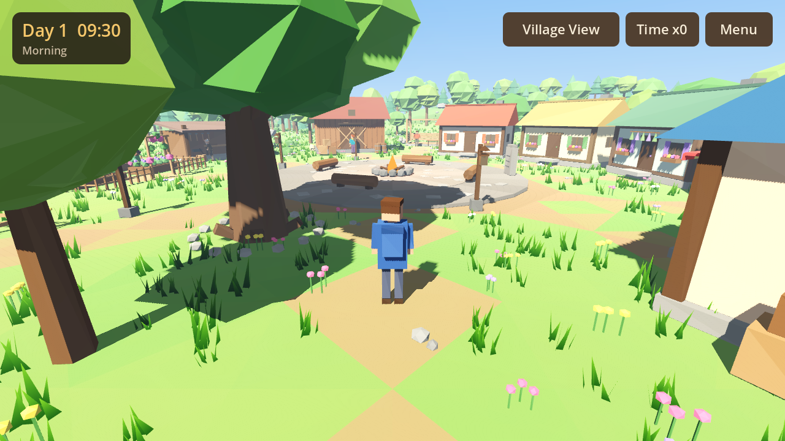 | 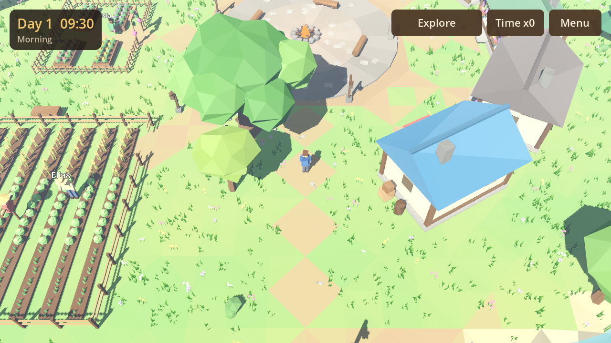 |
| **Night** | **Meeting a villager** |
| 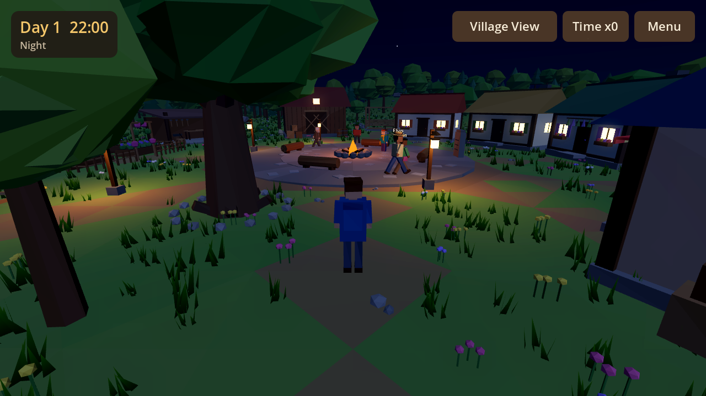 | 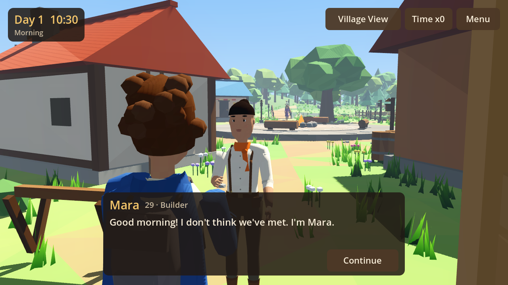 |

### The villagers

| Front | Back |
| --- | --- |
| 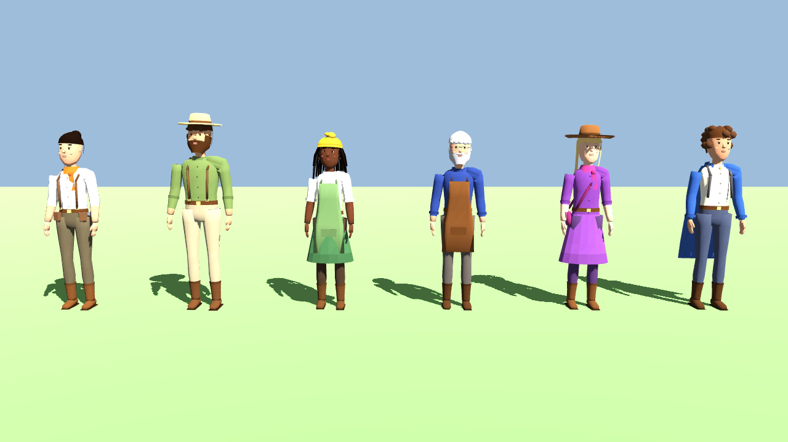 | 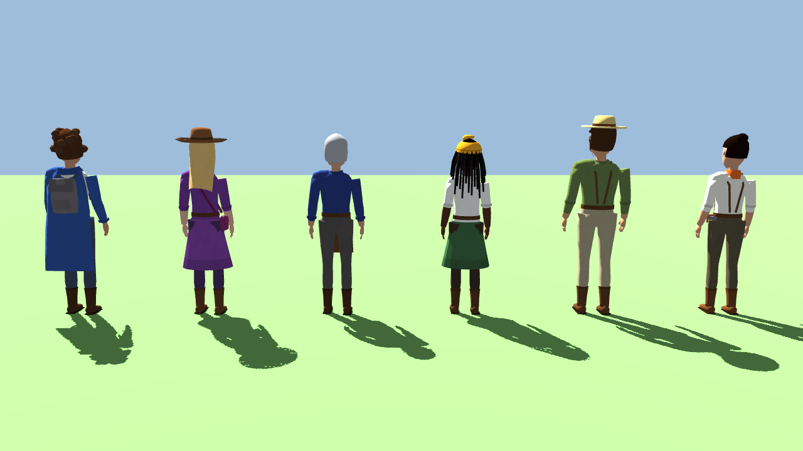 |
| **Running (skeletal animation)** | **Gathering (crouch, held tools)** |
| 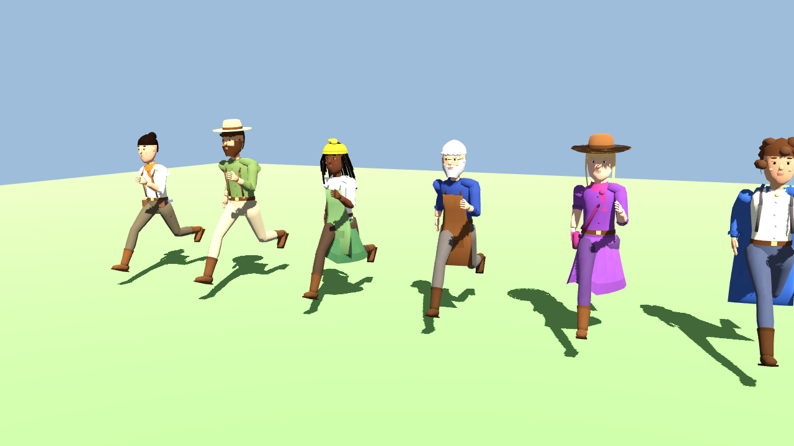 | 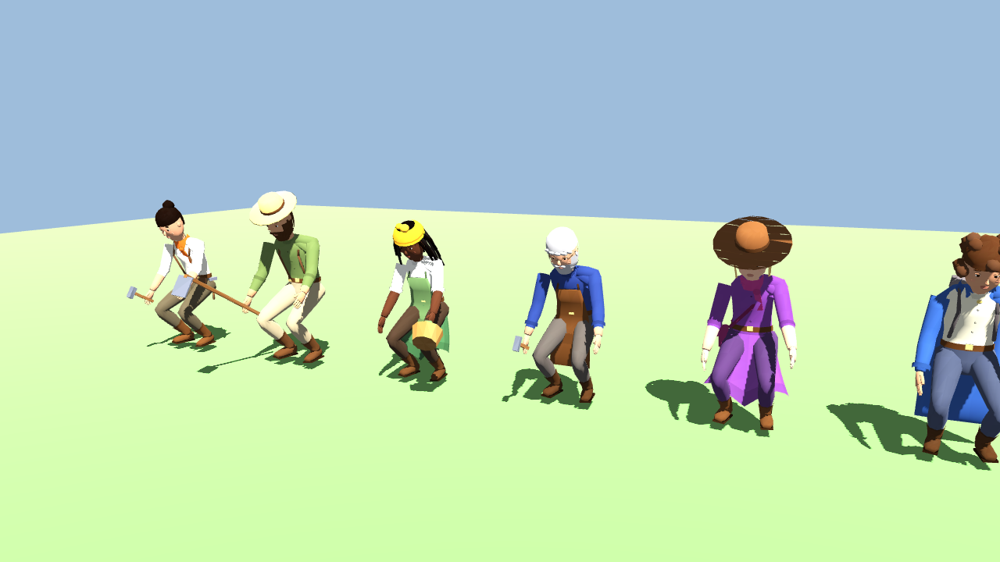 |

Left to right: Mara, Elias, Nia, Tomas, Sera, and the player. The target art direction is
[`docs/concept/characters_concept.png`](docs/concept/characters_concept.png); see
[Characters](#characters) for how close the current models get and how to reach it.

*Screenshots are from Godot 4.3's OpenGL (Compatibility) fallback renderer on a CPU rasteriser. On
phones the Mobile renderer is used, and lighting will look slightly different.*

---

## Milestone 1 contents

| Area | What exists |
| --- | --- |
| World | Procedural low-poly terrain (flat village, hills at the edges), river valley with flowing water shader, arched wooden bridge, forest across the river, meadows, rocks, reeds, mushrooms, wind-swept grass and flowers |
| Buildings | Five homes (each with its owner's colours and personal props), meeting circle with fire pit, log benches and story stone, fenced farm with wheat/cabbage/carrot rows and a scarecrow, herb garden with raised beds and trellis, open workshop with workbench and anvil, storehouse with crates and barrels, Mara's half-built sixth house, the old "memory oak", lantern posts |
| Characters | Fully modelled 3D people: skinned meshes on a 19-bone humanoid skeleton with anatomical torso, limbs, hands with fingers, shoes, sculpted faces (eyes, brows, nose, lips, ears), layered clothing, hair and accessories. Keyframed skeletal animations (idle, walk, run, jump, work, gather, talk, wave) with cross-fading and held tools |
| Player | Walk, run, jump, smooth turning, gravity, collision with buildings, trees, villagers, river banks and world edge |
| Cameras | Third-person orbit camera with wall avoidance, a high "Village View" management camera (pan, zoom, rotate, tap a villager for their info card), and an over-the-shoulder conversation camera. Smooth blends between them |
| Villagers | Mara, Elias, Nia, Tomas and Sera, each with a distinct look, age, role, traits, biography, walking speed and daily schedule. They walk the village paths, work, gather, trade, chat at the fire, go home at night and come out in the morning |
| Day / night | Moving sun and moon, keyframed sky colours, custom sky shader with stars and moon, ambient and fog colour changes, glowing windows, lanterns and fire light at night. Speed up time with **T** or the *Time ×* button |
| Interaction | Walk up to a villager and press **E** (or tap *Talk*). They stop, face you and introduce themselves. On later visits they remember you ("It's been 3 days since we last talked") |
| Memory | Each villager stores conversations in a memory log with a familiarity score. It is saved to disk, so the village remembers you between sessions |
| Mobile | Mobile renderer, multi-touch joystick, look and pinch controls, Low/Medium/High graphics presets, merged meshes and chunked MultiMeshes, distance-culled detail, autosave when the app is backgrounded |

### Controls

| Action | Keyboard / mouse | Touch | Gamepad |
| --- | --- | --- | --- |
| Move | WASD / arrows | Left-side joystick | Left stick |
| Run | Shift | Push joystick to the rim | LB |
| Jump | Space | *Jump* button | A |
| Look / orbit | Hold right mouse button and drag | Drag right side of screen | Right stick |
| Zoom | Mouse wheel | Pinch | none |
| Talk / use (chop, mine, build, plant, sit on a log or bench...) | E | Action button (its label shows the action) | X |
| Actions: wave, bow, cheer, dance, sit down, lie down / sleep | F | *Actions* button | none |
| Population | P | *People* button | none |
| Build menu | B | *Build* button | none |
| Rotate / place / cancel a building | R / E / Esc | *Rotate*, *Place*, *Cancel* buttons | none |
| Switch camera | Tab or C | *Village View* button | Y |
| Pan (Village View) | WASD, or drag with the left mouse button | One-finger drag | Left stick |
| Rotate (Village View) | Q / R, or drag with the right mouse button | none | Right stick |
| Select villager (Village View) | Click | Tap | none |
| Time speed | T | *Time ×* button | none |
| Menu / settings | Esc | *Menu* button | Start |

---

## Opening and running

1. Install **Godot 4.3 or newer** (standard build, not .NET): <https://godotengine.org/download>.
2. In the Project Manager choose **Import**, select this folder's `project.godot`, then **Import & Edit**.
   On first import Godot builds its `.godot/` cache. That folder is git-ignored.
3. Press **F5** (Run Project). The main scene is `res://scenes/main.tscn`.

### Automated smoke test

```bash
godot --headless --path . --import            # once, on a fresh clone (builds the .godot cache)
godot --headless --path . res://tests/smoke_test.tscn
```

The test loads the real main scene and checks that:

- the terrain, all buildings, the river, the bridge and the nature batches exist
- exactly five villagers exist, with the right ages, spread across the village
- the player stands on the ground, walks, runs faster than they walk, jumps and lands
- the camera switches to Village View and back, and the player is frozen while in Village View
- noon is bright, midnight is dark, windows glow at night, and villagers go home at night
- villagers walk around during the morning
- talking works: the villager stops, the greeting includes their name, they remember the conversation, the second greeting is different, and memory survives a JSON round trip

It exits with code `0` if every check passes and `1` otherwise. It never touches your save file.

### Gameplay test

```bash
godot --headless --path . res://tests/gameplay_test.tscn
```

Plays the whole first week in the real scene: chopping, mining, herb picking, regrowth, crafting tools,
placement checks (missing resources, river, meeting circle, cancel), building, planting and harvesting,
asking villagers for help (acceptance, refusals by personality, opinion and time of day, one job at a
time), helpers adding work and food, sleeping in your house, the village meeting, all seven objectives,
and a save/load round trip. CI runs both tests on every push.

Screenshots of a scripted play-through at phone resolution:

```bash
godot --path . --resolution 1612x720 res://tools/gameplay_screenshots.tscn -- --out=/tmp/shots
```

---

## Installing on an Android phone (no setup needed)

Every push to GitHub builds an installable APK automatically (`.github/workflows/build.yml`):

1. On GitHub, open **Actions → Test and build Android APK** and pick the latest green run.
2. Under **Artifacts**, download `TheVillageThatRemembers-apk` (a zip) and unzip it on your phone.
   You can also download it on a computer and copy it across.
3. Open `TheVillageThatRemembers.apk`. Android will ask you to allow installing apps from your browser
   or file manager. Allow it, then tap **Install**.

This is a debug build for an arm64 phone (almost every phone from the last six years). It's signed
with a throwaway debug key, so installing a newer build may require uninstalling the old one first.
Uninstalling also removes the save.

## Building an Android APK

The Android export needs the Godot editor and the Android toolchain. It cannot be done from this
repository alone.

1. **One-time setup**
   - Install the Android SDK (Android Studio is the easiest way) and **OpenJDK 17**.
   - In Godot: *Editor → Editor Settings → Export → Android*, set *Java SDK Path* and *Android SDK Path*.
   - *Editor → Manage Export Templates → Download and Install* (templates matching your Godot version).
2. **Create the preset**: *Project → Export → Add… → Android*.
   - *Architectures*: enable `arm64-v8a` (add `armeabi-v7a` for very old phones).
   - *Package → Unique Name*: e.g. `com.yourname.villagethatremembers`.
   - *Screen → Orientation* is already set to *sensor landscape* in Project Settings.
   - Debug builds are signed with Godot's debug keystore automatically. For a release build, create a
     keystore (`keytool -genkey -v -keystore release.keystore -alias village -keyalg RSA -validity 10000`)
     and enter it under *Keystore → Release*.
3. **Export**: click *Export Project*, untick *Export With Debug* for release, and save
   `TheVillageThatRemembers.apk`.
   Or connect a phone with USB debugging enabled and press the Android "remote deploy" button in the
   editor's top-right corner to install and run it directly.
4. `export_presets.cfg` contains machine-specific paths and passwords, so `export_credentials.cfg` is
   git-ignored. You can commit `export_presets.cfg` itself once you've created it if you want shared presets.

---

## Project structure

```
project.godot              Engine config (Mobile renderer, autoloads, physics layer names)
scenes/main.tscn           Entry scene (one node; everything else is built in code)
data/villagers/*.tres      The five villagers: identity, looks, schedule, dialogue, personality
shaders/                   sky, water, grass
scripts/
  core/                    Autoload singletons
    game_settings.gd         Quality presets and persisted settings (GameSettings)
    input_router.gd          Input actions; merges keyboard, gamepad and touch (InputRouter)
    world_clock.gd           Shared time of day, day counter, time speed (WorldClock)
    game_manager.gd          Registry of player and villagers, camera mode, conversations (GameManager)
    save_service.gd          Offline JSON save and autosave (SaveService)
  world/
    main.gd                  Bootstraps the world, player, camera, villagers and HUD
    village_layout.gd        THE source of truth: buildings, paths, waypoints, activity spots, river, bridge
    terrain_generator.gd     Height function, terrain mesh and collision, painted paths
    mesh_builder.gd          Flat-shaded vertex-coloured primitive merging
    materials.gd             Shared materials
    building_factory.gd      Every building and prop, assembled from primitives
    village_builder.gd       Places buildings from the layout
    river_builder.gd         Water, bank walls, world bounds, bridge
    nature_spawner.gd        Chunked MultiMesh trees, grass, rocks and so on
    village_navigation.gd    AStar3D waypoint graph and activity-spot reservations
    day_night_cycle.gd       Sun and moon, sky, ambient light, fog, night lights
    fire_flicker.gd          Campfire animation
  player/
    player_controller.gd     CharacterBody3D movement
    camera_rig.gd            Exploration and management cameras
  characters/
    character_appearance.gd  Resource describing how someone looks (colours, body, clothes, hair)
    character_model.gd       Skeleton + skinned body + AnimationPlayer + held tool; set_animation()
    humanoid_rig.gd          19-bone skeleton (Godot humanoid bone names), rest pose
    humanoid_mesh_builder.gd Generates the skinned body, face, clothing, hair and accessories
    humanoid_animations.gd   Bakes the skeletal animation library (per posture)
    skinned_mesh_tool.gd     Low-level skinned geometry: lofts, ellipsoids, smooth normals
  villagers/
    villager_data.gd         Static identity resource
    villager.gd              Runtime villager: walk, perform, sleep, talk
    villager_brain.gd        Decision interface (choose_activity)
    schedule_brain.gd        Milestone 1 brain: follows the timetable
    villager_activity.gd     What and where
    villager_mind.gd         Inner state: memory and relationships (extension point)
    memory_log.gd            Episodic memory
  interaction/
    interactable.gd          Area3D component: "this can be interacted with"
    interaction_detector.gd  Player's sensor that picks the best target
    dialogue_service.gd      Builds what a villager says
  ui/                      HUD, dialogue, villager card, settings, touch controls, theme
tests/                     Headless smoke test
tools/                     Character gallery and in-game screenshot tools (see Characters)
docs/                      Screenshots and the character concept art
```

### Architecture notes

- **Built in code, configured by data.** Geometry is generated from primitives, so the project has
  no binary assets and no fragile hand-edited scenes. Characters are `.tres` resources you can edit
  in the Inspector.
- **One layout file.** `VillageLayout` describes where everything is. The terrain paints paths from
  the navigation edges, decoration avoids footprints and paths, and villagers walk the same graph.
  Moving a building there moves everything with it.
- **Brains are swappable.** `Villager` only calls `brain.choose_activity(villager, hour)`. The
  planned needs, emotions and personality-driven AI is a new `VillagerBrain` subclass, and nothing
  else has to change. `VillagerData.personality` is already authored for each villager but not read yet.
- **The mind is the extension point.** `VillagerMind` owns memories and relationships. Needs,
  emotions, family links and ambitions belong there and are saved with it.
- **Decoupled systems.** Systems talk through `GameManager` signals (`conversation_started`,
  `villager_selected`, `camera_mode_changed`) rather than holding references to each other.
- **Physics layers.** 1 world, 2 player, 3 villagers, 4 interaction, 5 boundaries (invisible walls,
  ignored by the camera).

### Performance choices for affordable phones

- Mobile renderer. One directional light, which is the sun by day and the moon by night. Moonlight
  casts no shadows. Shadow distance and atlas size scale with quality.
- Each building is **one merged mesh** plus one glow mesh. Vegetation is **chunked MultiMeshes**
  (one draw call per type per 24 m chunk, culled per chunk). Grass, flowers and pebbles are
  distance-culled and cast no shadows.
- Ambient light comes from a flat colour and sky reflections are disabled, so the sky never forces
  costly radiance updates. Sky and fog parameters update ten times a second, not every frame.
- Villagers move along waypoints without physics queries. The only per-frame raycast is the camera's
  wall check.
- Quality presets (Low/Medium/High) control shadows, render scale (75/90/100 %), MSAA, glow, grass
  density and detail distance. On mobile the default is Medium.

---

## Milestone 2: the village remembers

- **Conversations with choices.** Each villager has three personal topics that unfold over your visits
  (`scripts/dialogue/conversation_library.gd`). You answer with one of three choices: helpful,
  curious, or careless or rude.
- **Opinions.** Every villager keeps a *warmth* and a *trust* score for you (`VillagerMind`). Your
  choices move them, and they shape greetings ("There you are! I was hoping you'd come by." or
  "Oh. It's you."), expressions, and the info card ("Feels about you: Friendly").
- **Memories come back.** Memorable choices are stored as deeds. On a later day the villager brings
  them up once: "I haven't forgotten that you offered to help build the new house."
- **Gossip.** Villagers chatting together pass on what you did (`GossipSystem`). The listener
  remembers who told them, forms a weaker opinion of their own, and asks you about it:
  "Mara told me you called her new house crooked. Is that true?" If you're nearby, you'll see
  "Sera is telling Tomas about you...".
- **Consequences.** Push a villager's warmth low enough and they won't chat until you apologise.
- Everything is saved with the rest of the game, so the village keeps remembering between sessions.

## Characters

Every person is a real 3D model built at load time from their `CharacterAppearance`:

- **Skeleton.** `HumanoidRig` has 19 bones named after Godot's `SkeletonProfileHumanoid` (`Hips`,
  `Spine`, `Chest`, `Neck`, `Head`, `LeftUpperArm`, `LeftLowerArm`, `LeftHand`, `LeftUpperLeg`, and so on).
- **Body.** `HumanoidMeshBuilder` lofts smooth cross-sections into one skinned mesh. Vertices at the
  elbows, knees, shoulders and waist are weighted between two bones so they bend instead of breaking.
  Long skirts are weighted toward the thigh on each side so they swing with the legs.
- **Animation.** `HumanoidAnimations` bakes real keyframed rotation tracks (plus a hips position track)
  into an `AnimationLibrary`. An `AnimationTree` blends idle into a walk/run mix driven by actual speed,
  sets playback rate from stride length so feet don't slide, and cross-fades into actions (jump, work,
  gather, talk, wave). Each character's posture (Tomas's stoop) is baked in.
- **Budget.** Each villager is about 3,500–4,200 triangles in one draw call, plus a small tool mesh.

### Faces

Each head is a separate skinned mesh on the same skeleton, so the body, rig and animations are
unchanged. The head is sculpted from a 30×32 grid of cross-sections with a brow ridge, eye sockets,
cheekbones, nose bridge, muzzle and chin. It also has:

- **Eyes:** eyeballs with a layered iris, pupil and catchlight; upper and lower eyelids with a lash line.
- **Features:** curved brows, a nose with nostrils, separate upper and lower lips over a mouth with
  teeth, and sculpted ears.
- **Skin:** per-vertex colour (warm cheeks, nose and chin, soft shadow around the eyes) on a dedicated
  skin material with wrapped diffuse lighting, a faint rim light and no self-shadowing.
- **Character traits:** each one comes from `CharacterAppearance` face parameters: jaw, chin,
  cheekbones, brow shape, eye size and tilt, nose, lips, wrinkles, freckles and a resting expression.
- **Expressions:** `CharacterModel.set_expression(name)` with neutral, happy, laughing, sad, angry,
  surprised and worried. These are blend shapes defined once in `FaceExpressions` and generated for
  every character, plus automatic blinking and mouth movement while speaking.
- **Dialogue tags:** a line can start with a tag such as `[laughing]` to set the face for that line.
- **Cost and caching:** about 6,000–7,000 triangles and about 3,500 vertices per head. Meshes are cached
  in `user://character_cache`, so after the first launch all five villagers load in under 20 ms.

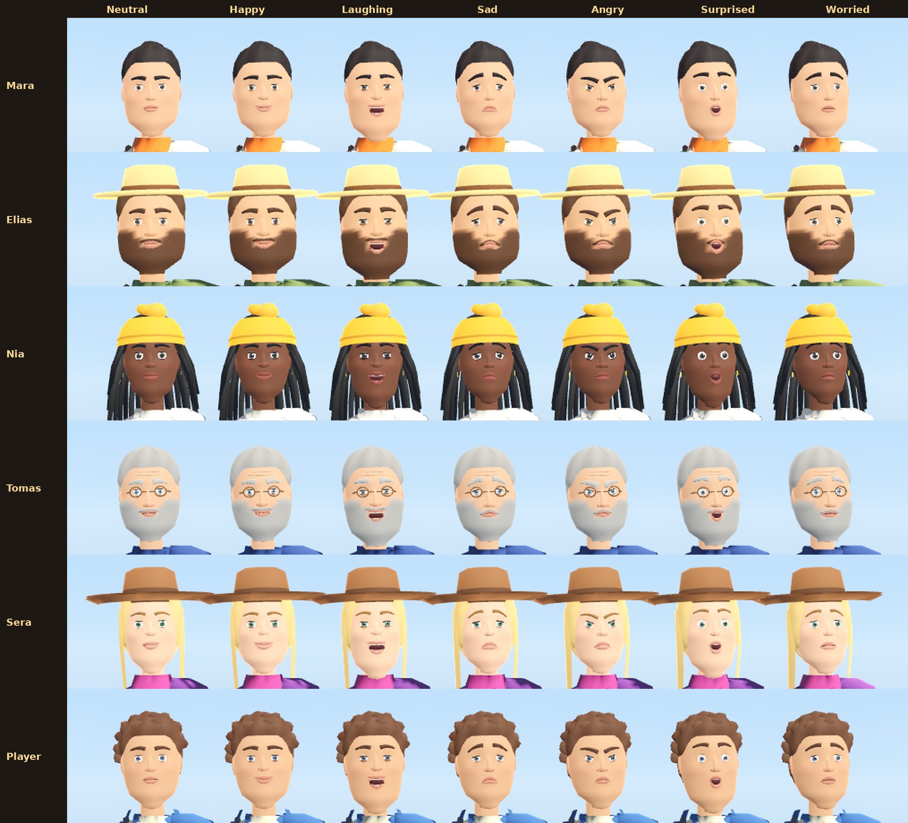

| Conversation | Village View portrait |
| --- | --- |
| 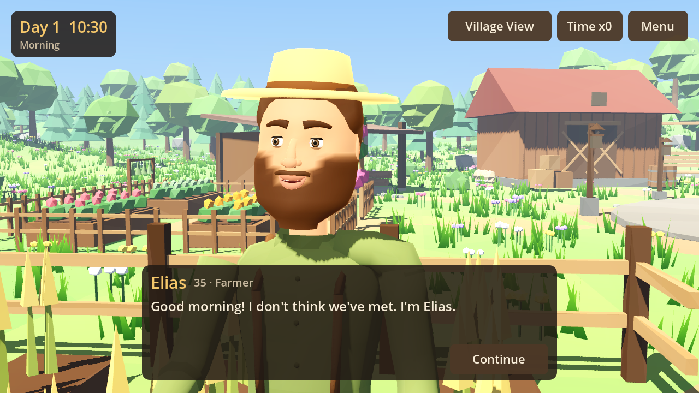 | 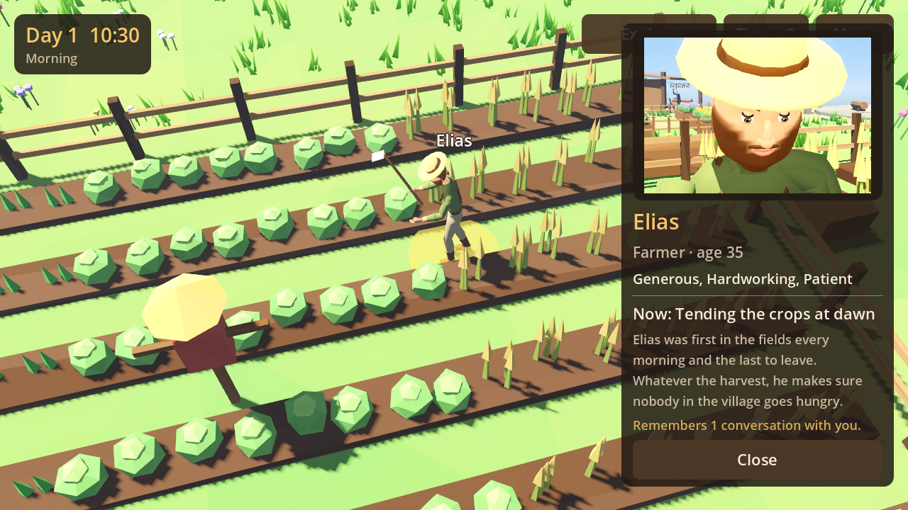 |

More are in `docs/screenshots/faces/`: per-character before/after comparisons, close-ups, every
conversation, and evening light. Render your own with
`godot --path . res://tools/face_gallery.tscn -- --out=/tmp/faces`.

To review character art without playing, render every character from five angles and in every
animation:

```bash
godot --path . res://tools/character_gallery.tscn -- --out=/tmp/gallery
godot --path . res://tools/game_screenshots.tscn -- --out=/tmp/shots   # in-game views
```

### Reaching the concept art

The concept art is painted, semi-realistic work: sculpted faces, cloth folds, textured leather,
individual braids. Code-generated geometry can't reach that fidelity; it needs artist-authored models.
The project is set up so they can drop in:

1. Model and texture each character in Blender (or a character creator), rigged to a humanoid skeleton.
2. Export as glTF (`.glb`) and import into Godot. In the import dialog, set the skeleton's
   *Bone Map* to `SkeletonProfileHumanoid` so the bones get the same names used here.
3. In `CharacterModel._build()`, instance the imported scene instead of calling `HumanoidMeshBuilder`.
   Keep the `Skeleton3D` named `Skeleton3D`.

The existing `HumanoidAnimations` clips then drive the imported model, or imported clips (such as
Mixamo animations retargeted through the same bone map) can replace them. The player, villager,
camera and test code don't change.

## Playing the village: your first week

You arrive with nothing. The objective panel (top left) walks you through one goal per day, but nothing
is locked: you can gather, build and ask for help in any order and keep playing after the week ends.

| Day | Objective | How |
| --- | --- | --- |
| 1 | Meet the villagers | Talk to all five |
| 2 | Gather materials | 10 wood (forest, west) and 6 stone (rocks, north) |
| 3 | Build a farm plot | *Build* → Farm plot, place it, then work on the site |
| 4 | Harvest food | Plant seeds, wait about 8 hours, harvest |
| 5 | Ask a villager for help | Talk → "Could you help me with something?" |
| 6 | Build your own house | 20 wood, 10 stone; sleep in it to skip the night |
| 7 | Hold a village meeting | Use the fire pit in the evening |

- **Gathering.** Trees give wood, rocks stone, the herb patches herbs. Each lasts three uses and grows
  back the next morning. Crafting tools at the workshop bench (4 wood, 3 stone) adds +1 per use.
- **Building.** The Build menu shows cost and purpose. The preview turns red with the reason when you
  can't build there (missing resources, the river, paths, other buildings, too steep). Placing spends
  the resources and leaves a construction site you or a villager finish. Farm plot, house, well (waters
  crops), bench (sit) and lantern.
- **Villager help.** Ask for building, wood, stone or farming. Answers depend on who you ask (Mara loves
  building, Tomas's knees keep him out of the quarry), how they feel about you, the time of day, and
  whether they're already busy. Helpers walk to the job and their work shows up in your stock.
- **The meeting.** Everyone walks to the fire. Each villager says a few words shaped by their opinion of
  you and what you've done. It's remembered and raises everyone's opinion.
- Inventory, buildings, crops, depleted resources, objectives and tasks are saved.

## A growing village: population

The five founders (Mara, Elias, Nia, Tomas and Sera) are where the village starts, not where it ends.
They keep their hand-written identities; everyone after them is generated.

**New arrivals.** From day 2, travellers walk in over the bridge, at most one at a time, more often
when there are free beds. Each newcomer is generated (`scripts/population/`):

- **Looks:** skin tone from a wide palette, hair colour, style and greying with age, eye colour, face
  shape, height and build, dyed clothes, accessories suited to their trade. Ten candidates are made and
  the one that looks least like anyone already living here is kept (`AppearanceGenerator`). Relatives
  start from a family member's look.
- **Who they are:** a unique name, an age, six personality values with three resulting traits, ten
  skills with one real talent, a profession (talents lean towards trades the village lacks), an
  ambition, a short history, a timetable shaped by their personality, and lines of their own.
- **Meeting them:** they wait at the meeting circle. Talk to them to welcome them, hear more, or turn
  them away. Kind villagers approve of a welcome and are hurt by a refusal; a newcomer's relatives take
  a refusal personally. A traveller nobody speaks to moves on after two days.
- **Homes:** each founder's house has a spare bed, the new **Cottage** (Build menu, 18 wood and 8 stone)
  houses four, and anyone without a bed sleeps at the travellers' camp east of the river until a
  cottage is finished.

**Independent lives** (`SocialLife`). Villagers near each other get to know each other every hour;
how fast depends on how well their personalities fit. Friendships form, single adults fall for each
other, move in together and later marry. Every day each villager weighs up a home, friends, a partner,
work that suits them and how you treat them. After a few unhappy days they may decide to leave, and
you can talk them into staying. Happy villagers send for a sibling, cousin, parent, child or friend, who
arrives with the family name and a family resemblance. Ambitions progress and come true.

**Children and generations.** Happy couples have babies, with looks and personality from both
parents. Babies stay at home; at three they get their own child-sized 3D body. Children play at the
meeting circle and riverbank, help a parent at work and go to bed early, and their body is rebuilt as
they grow. At 13 they start an apprenticeship (often a parent's trade), and at 18 they come of age and
later move out. Couples who can't have a baby together may adopt a child who needs a home. People grey,
wrinkle and stoop as they age, elders die of old age, homes are inherited, and family mourn: the village
remembers those who died. The founders are protected from old age for now. A village year is 10 days,
and the *Years pass* setting in the menu changes it to 30 or 4.

How children are built: everyone is modelled as an adult, then `BodyProportions` reshapes the skeleton
joints, body, head and every expression shape the same way. Legs and torso shrink most, the head least,
and the body narrows. Each leg length gets its own animation set, so children's hips sit lower and
their steps are shorter and quicker. `AgeLook` gives children bigger eyes, smaller noses and rounder
chins, and drops beards and work tools. Tools: `tools/age_gallery.tscn` (one person from 3 to 72) and
`tools/generations_screenshots.tscn`.

**Population panel** (*People* button or **P**): total population, adults, teenagers, children
(and babies) and elders, couples, babies on the way, generations, apprentices, happiness, occupations, beds in homes, free beds and campers, arrivals, departures,
people turned away, births, deaths, partnerships and marriages, every villager, recent events and the
people the village remembers. Tap a villager to see their family tree.

**Performance on phones.**

- **Population cap:** the village stops attracting travellers at 50 people.
- **Building characters:** a new character's head takes about half a second to build, so it's built on
  a worker thread and cached, and characters appear one by one, never all at once (also after loading).
- **Detail by distance:** beyond 16 m a villager swaps their 6,000-triangle expressive head for a
  stand-in of about 150 triangles and animates every other frame. Beyond 38 m they animate every fourth
  frame and cast no shadow. Off-screen and sleeping villagers don't animate at all.
- **Shared assets:** every generated character uses the same skeleton, animations and materials.
- **No shared spots:** busy places hand out extra spots in rings around the usual ones, so two people
  never stand on the same spot.
- **Less work per villager:** names and detail are re-checked four times a second, staggered across
  villagers; animation parameters and face blend shapes are only written when they change; and distant
  people's movement updates every third frame.
- **Measured CPU cost** per frame on the test machine's desktop CPU, best of six windows, headless so
  no rendering: five founders 1.8 ms; 50 villagers 4.5 to 5.6 ms with distance detail, 7 to 8 ms without.
  This hasn't been measured on a phone yet.

Tests: `godot --headless --path . res://tests/population_test.tscn` (93 checks). Screenshots:
`godot --path . --resolution 1612x720 res://tools/population_screenshots.tscn -- --out=/tmp/shots`.

## Living in the village

**Things you can do anywhere** (*Actions* button or **F**): wave, bow, cheer, dance, sit down and lie
down. At night, lying down sleeps until morning, but villagers will ask whether you slept outside.
Sit on the logs round the fire or on a bench you built (**E**); moving stands you up.

**Villagers notice you.** They wave back, bow back, cheer, join a dance (the outgoing ones) or grumble
(the blunt ones). They greet you as you pass, differently by time of day, mood and personality. They
sit on the logs to chat in the evening. Each person's tone comes from who they are and how they feel
about you: warm, cheerful, shy, grumpy, cold or childlike (`LineBank`).

**Good and bad deeds** (in conversation, *Be kind...* / *Be unkind...*):

- **Kind:** give a gift (each trade has favourites: builders like wood, cooks like herbs), pay a
  compliment (less effective if you keep repeating it), tell a joke (lands better with open, outgoing
  people).
- **Unkind:** play a prank (playful people laugh, others don't), insult them, or steal from their
  pocket. A theft is often caught, and if it isn't, they find out the next day.
- **Consequences:** every deed changes their warmth and trust, is remembered and brought up later,
  spreads as gossip, and is seen by anyone standing nearby, who remembers it too and says something.
  Insult someone enough and they won't talk to you until you apologise.

**Conversations that keep changing** (`Chatter`). After the first meeting, villagers talk about:

- **Village news:** births, weddings, newcomers, deaths, coming of age, new buildings.
- **Each other:** friends, rivals, what a neighbour is doing right now.
- **Their own life:** their trade, ambition, partner, children, mood, or that the tent is cold.
- **You:** your reputation, if your deeds are getting talked about.
- **The moment:** the time of day and what they're doing.

Each villager remembers what they've told you and moves on to something else. *What's new?* asks for
more until they run out ("You've heard all my news today!"). Greetings vary too.

**Voices** (Settings → Voices). *Spoken* reads villagers' lines aloud with the device's own
text-to-speech voices (Android, Windows, macOS, Linux with speech-dispatcher). Android's voices are
recognised by their codes (Google's `en-us-x-iom`, Samsung's `SMTm`...) as women's or men's. Each
villager gets a voice of their own (nobody shares until all are in use) plus their own pitch and pace:
children higher, elders slower, outgoing people faster. You speak too: when you pick an answer in
words, it appears as yours ("You") and is said aloud in your own voice before the villager replies
(answers that are actions, like "Pay them a compliment.", aren't). *Test voices* plays a few of them; more voices
can be installed in the phone's Text-to-speech settings. *Babble* is a
murmur generated on the device in each person's pitch range, one blip per syllable, rising for
questions. *Off* is silent. Nearby villagers' greetings and reactions are voiced too, and speech
bubbles show what they say.

Tests: `godot --headless --path . res://tests/life_test.tscn` (45 checks). Screenshots:
`tools/life_screenshots.tscn`; every pose: `tools/pose_gallery.tscn`.

## Building your village

**Wood and stone:** every tree and rock around the village can be worked. Walk up to one and tap
*Chop* or *Mine* (2 wood or stone a time, 3 with tools). A tree comes down after three chops and a
rock breaks up after three blows; they grow back three days later (`WildHarvest`).

A new village starts with 20 wood, 10 stone, 4 food and 3 herbs, enough to build your own house straight away. The
**Build** menu has three tabs:

| Tab | What you can build |
| --- | --- |
| Homes | Your house (sleep there), cottages (four newcomers each). |
| Food | Farm plot, chicken coop (2 food every morning), fruit tree (grows in two days, then fruit every day), well (waters crops). |
| Village | Bench, lantern, flower bed, fence, stone path, market stall, founders' stone. |

- **Building in stages:** placing something leaves a construction site you (or a villager) work on.
  Homes rise in stages: posts, walls plank by plank, roof beams, then thatch.
- **Village beauty:** flowers, lanterns, fences, paths, the market and the founders' stone add to it,
  which makes villagers happier, and they notice and talk about it.
- **Can't afford it yet?** Each item says what's missing ("need 3 more wood"), tapping it explains
  inside the menu, and the menu opens on a tab where you can build something now.
- **Placing:** the preview follows you, green where it can go. If the spot ahead is taken (a tree,
  steep ground, a path), it jumps to the nearest free spot; it's red, with the reason, only when
  there's no room nearby. Building clears the wild trees, bushes and rocks under it.
  *Rotate*, *Place* and *Cancel* sit at the bottom of the screen.
- **Move something / Remove something** (bottom of the Build menu): walk up to anything you built and
  tap it. Moving is free. Removing gives back half the cost, and people living in a removed cottage
  find another home.

Tests: `godot --headless --path . res://tests/build_test.tscn` (52 checks). Screenshots:
`tools/build_screenshots.tscn`.

## Reasons to come back every day

**While you were away...** The village keeps living while the game is closed or in the background.
When you come back, the clock moves on by the time you were gone (at normal speed, at most one village
day, so a week away never ruins anything). Days pass, babies are born, travellers arrive, friends
talk by the fire or argue at the well, helpers keep working and crops ripen. Then a short story tells
you what happened (`AwayTime`).

**Today's requests.** Each morning two to four villagers ask you for something that comes from their
own lives (`RequestBoard`):

- **Bring something:** "Tomas has a fever again. Could you bring me 3 herbs?"
- **Pass on a message:** an apology, a thank-you, an invitation to sit by the fire.
- **Check on someone:** a mother worried about her son, someone whose partner has been quiet lately.

A **!** floats over people asking for something and a **…** over people a message is for. The
*Today's requests* card under the objective lists them. Doing a request is warmly thanked, sometimes
with a gift, and remembered. Passing on a message changes how the two villagers feel about each other
too. A request left undone is remembered gently ("You never came by with the firewood yesterday. It's
alright.").

Tests: `godot --headless --path . res://tests/hooks_test.tscn` (31 checks). Screenshots:
`tools/hooks_screenshots.tscn`.

**A welcome gift each day** (`DailyGift`). The first visit of each real day brings a small gift from a
villager ("Mara left a loaf of warm bread at your door."): food, wood, stone or herbs in turn, and every
seventh visit a bigger basket from the whole village. Missing days costs nothing: gifts follow your number
of visits, not a streak. Days are UTC days (in Rwanda a new day starts at 02:00), so changing the time zone
doesn't make a new day. A clock set back is noticed and gives nothing until real time catches up. Pushing the
clock ahead only takes tomorrow's gift early. The record is signed inside the save, and a signed copy outside
it means "Forget everything" doesn't give a second gift the same day.

**A festival every week** (`Festival`). From the second week on, days 5 and 6 of each village week are a
festival, announced the day before, in turn: the **Harvest Festival** (bring in food, give gifts), **Lantern
Night** (build a lantern, join everyone at the fire after dark), the **Builders' Fair** (chop wood, finish a
building) and **Story Night** (talk with four villagers, hear the stories at the fire). Bunting goes up around
the meeting circle, villagers greet you with festival talk in their own manner, everyone dances at the fire in
the evening, and a card on the right shows the optional goals. Each goal pays a reward. Doing them all gives a
bonus and makes everyone happier. Afterwards the village talks about it. Progress is saved. A village week
is about two hours of play.

**Stories from what really happened** (`VillageStories`). Built on the villagers' memories and relationships:
- *The day you met*: a week after your first talk, someone who has come to like you remembers it.
- *Repaying a kindness*: a villager who likes you, and remembers a particular kind thing you did ("you helped
  me fix the barn roof"), thanks you properly with a gift from their trade.
- *Making peace*: a friend of yours who has fallen out with someone asks you to carry a peace offer. If the
  other person trusts you, they make up, thank you, and the village talks about it. If not, they refuse, and
  your friend thanks you for trying.

Each story happens once per person or pair. It is checked against the present (nobody who has left, no
warm stories from someone hostile to you) and saved.

**Rewarded ads, always optional** (`AdRewards`, Gifts button). Watching an ad gives the village a gift: a
merchant's caravan, a blessed harvest, a feast or a traveller. There are never forced, banner or pop-up ads.
At most 6 a day, 2 minutes apart. A gift is given only when the ad network confirms the ad was watched
(including when that confirmation comes just after the ad closes). Debug builds always use Google's test ads.
Release builds use test ads until a real unit ID is put in `PRODUCTION_REWARDED_UNIT_ID`. The AdMob plugin
isn't in the project yet (see the release checklist below). Without it, release builds show no ads and debug
builds show a simulated ad.

Tests: `godot --headless --path . res://tests/retention_test.tscn` (59 checks). Screenshots:
`tools/festival_screenshots.tscn`.

## The guide

The current objective always says what to do next, and shows where:

- **A marker** floats over the next thing to do: the next villager to meet, the nearest tree to chop or
  rock to mine, your building site, your farm plot, the fire for the meeting.
- **An arrow at the edge of the screen** points to it when it's behind you or off to the side, with
  how far it is ("Nia · 24 m").
- **Building:** when the next step is to build something, the Build button glows and the Build menu
  opens on it, marked "★ your next step". Short of materials, the guide sends you to a tree or rock.
- **Rewards:** each finished objective brings a gift from the villagers (food, wood, stone, herbs).

Tests: `godot --headless --path . res://tests/guide_test.tscn` (17 checks). Screenshots:
`tools/guide_screenshots.tscn`.

## Adventure, milestone 1: homes, a livelier village, the first fight

The plan for turning the village into a village-life adventure (audit, what's missing, the technical plan,
the order of work) is in [docs/ADVENTURE_PLAN.md](docs/ADVENTURE_PLAN.md). Milestone 1:

- **Walk into homes.** Every founder's home has a front door ("Enter Mara's house"; at night you can only
  knock). Inside is a furnished room with its owner's colours and belongings: Mara's drawing table and
  plans, Elias's seed sacks and vegetables, Nia's drying herbs and potted plants, Tomas's workbench, Sera's
  crates and cloth. Sit at their table. Your own house has your bed (sleep the night, or nap and heal) and a
  hearth where you cook **stew** (2 food, 1 herb) that heals you in a fight. Rooms are built when you go in
  and freed when you leave: a short fade, no loading. Saving indoors saves the doorstep.
- **A livelier village.** Flower planters by every front door, an herb bed beside every home, and a market
  corner with two stalls by the meeting circle. Trees that come between the camera and you are hidden
  while they're in the way.
- **The first fight.** Forge a **sword and shield** at the workshop bench (8 wood, 6 stone, after the tools).
  Tomas then asks you to chase the **thornlings** out of the west woods: bramble-red, thorny little creatures
  that wander, notice you, give chase, clearly wind up (crouch, bristle, squeak) and lunge, then need a
  moment to recover. They take turns: one attacks while the others circle. Swing (F, or **Attack**), hold the shield up (Q, or **Block**: 80% less damage when facing
  the blow), **Dodge** (C) past a lunge, and **Eat** a stew (H) to heal. Three hits beat a thornling; it pops and
  leaves herbs. Clearing the woods pays 12 wood, 8 stone and 3 food, and Tomas remembers it. They come back two
  days later for a smaller reward. Afterwards the bench can put a **steel edge** on the sword (hits twice as
  hard). Health comes back on its own out of a fight. Being knocked out sends you home a couple of hours
  later with nothing lost. On a phone, the fight buttons appear only when you're armed and something hostile
  is near. Violence is stylised: no blood, creatures pop.

Not in this milestone (see the plan): other enemy kinds, bosses, caves, areas beyond the village, raids,
a quest log, shops, weather, location music. None of it has been tried on a real phone yet.

Tests: `godot --headless --path . res://tests/adventure_test.tscn`. Screenshots:
`tools/adventure_screenshots.tscn`.

## Sound and music

Everything you hear is made by the game itself, on the device, with no audio files (`scripts/audio/`):

- **Music:** a plucked melody over warm chords for the day, and slower music-box bells for the night,
  cross-fading at dusk and dawn. The themes are composed on first launch in the background (about five
  seconds) and saved, so later launches start the music straight away (`Music`).
- **Effects:** the axe going into wood, a pick on stone, rustling herbs, hammering, footsteps, a chime
  when something's built, button clicks, a bell for notices and requests (`SoundBank`).
- **The village:** wind, birds by day, crickets at night and the fire crackling at the meeting circle
  (louder as you walk up to it).
- **Settings:** separate volumes for *Music*, *Sound effects* and *Birds, wind and fire*, remembered
  between launches.

Tests: `godot --headless --path . res://tests/sound_test.tscn` (25 checks). To listen without the game,
`godot --headless --path . -s res://tools/sound_check.gd -- --out=/some/dir` writes every sound to WAV.

## Status

### Implemented

Everything listed under [Milestone 1 contents](#milestone-1-contents).

### Verified

Tested with **Godot 4.3-stable** (official Linux build):

- The headless smoke test passes **96/96 checks**, the gameplay test **46/46** and the population test **93/93**, the life test **56/56**, the hooks test **31/31**, the build test **52/52**, the sound test **25/25**, the guide test **19/19**, the retention test **59/59**, the adventure test **49/49**, including the skeleton, skinning, triangle budget, animations and facial blend shapes of every villager (`godot --headless --path . res://tests/smoke_test.tscn`, exit code 0).
- A soak run through **two full in-game days at ×100 speed** produced no script or runtime errors.
- Rendered screenshots (above) in exploration and Village View, at morning, sunset and night, and during
  a conversation.

### Not yet verified

- The **Mobile (Vulkan) renderer**. The screenshots used the OpenGL fallback because this machine has no GPU.
- **Performance and touch controls on a real Android device**, and the APK export itself.
- Two engine messages, `Parameter "m" is null` (`mesh_get_surface_count`), appear only in headless mode,
  when the terrain and river meshes are freed at shutdown. They come from the dummy renderer and don't
  affect gameplay or test results.

### Known limitations

- Characters are stylised and code-generated, so they're simpler than the painted concept art. There are
  no textures, cloth folds or facial expressions yet. See [Reaching the concept art](#reaching-the-concept-art).
- Skeletal animations are hand-keyed in code (no motion capture), and feet aren't IK-planted on slopes.
- Tomas is 61 in the design brief but looks about 30 in the concept art. The game follows the brief
  (grey hair and beard).
- Changing the grass density preset applies on the next launch. Everything else applies immediately.
- Villagers do not avoid each other. They wait briefly if the player blocks their way, then carry on.
- Villagers sleep indoors (hidden). Houses have no interiors yet.

### Before a Play Store release

- **AdMob:** add the Poing Studios AdMob plugin (`addons/admob`, Android plugin enabled in the export preset),
  create an AdMob account, put the AdMob App ID in the plugin's Android settings, and put the rewarded unit
  ID in `PRODUCTION_REWARDED_UNIT_ID` (`scripts/core/ad_rewards.gd`). Until then no real ads are shown.
- **Release signing:** CI builds a *debug* APK signed with a throwaway key. The Play Store needs a release
  build (AAB) signed with your own upload key. Keep that key safe: it can't be replaced.
- **Play Console:** a developer account, store listing, privacy policy (needed with ads), the Data safety
  form (AdMob collects device data), content rating, and ads declared in the listing.
- **Testing on real phones:** performance, touch controls and the Vulkan renderer haven't been measured on
  a device yet (only the OpenGL fallback headless and under a virtual display).

### Next milestones (not started)

Needs and emotions, a fuller economy, and expanding the settlement.
